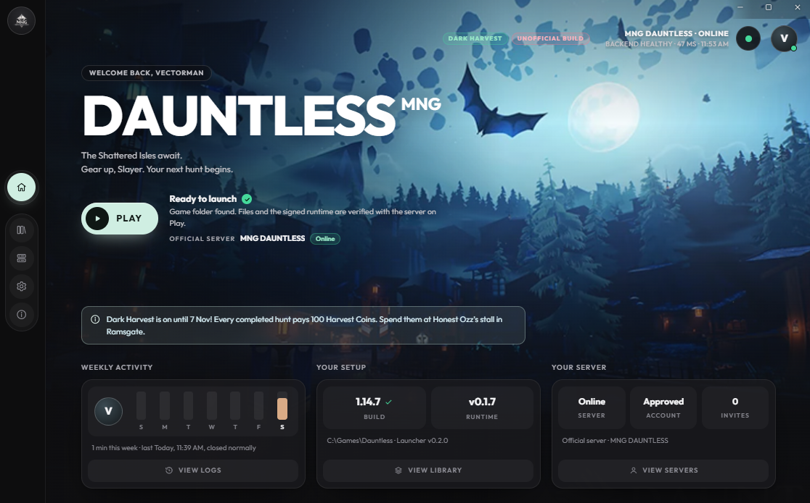

<h1 align="center">MNG DAUNTLESS</h1>

  <b>A private Dauntless 1.14.7 server for the MNG community.</b> 
  Hunt, craft and run the seasonal events of Ramsgate again, with your friends.

  

  
  
  

## Disclaimer
This project is mostly made with claude and built on an already existing project for a specific community

## Play

1. **Get the launcher**: download `MNG-DAUNTLESS-Launcher-<version>-setup.exe` from the [Releases](../../releases) page and
   install it. Windows may warn that the publisher is unknown (the installer is not code-signed): choose *More info* then
   *Run anyway*.
2. **Get the game**: you need Dauntless **1.14.7** (build 647472). If you do not have it, the release also has the
   **MNG Game Downloader**: unzip it and run `Download-Game.bat` (about 15 GB; it checks every file).
3. **Create your account** in the launcher, choose your game folder, and press **Play**.

The launcher connects to the MNG DAUNTLESS server by itself and keeps the game's runtime files up to date.

## What is in the game

- Hunts, Escalations, the Trials and the Gauntlet, crafting, cells and the Slayer's Path.
- The Legacy Hunt Pass: free premium, 4-week seasons, earned by playing.
- Seasonal events with Ramsgate's decorations and Honest Ozz's event shop: Dark Harvest, Ramsgiving, Frostfall,
  Saint's Bond, Springtide and Midsommar. Completed hunts pay the event's currency.

See [CHANGELOG-MNG.md](CHANGELOG-MNG.md) for everything MNG DAUNTLESS changed, and [TODO-MNG.md](TODO-MNG.md) for what is
being worked on.

Game data extracted from Dauntless, the server's database, keys and certificates are never in this repository.

## Credits and license

MNG DAUNTLESS is a modified version of **[Mystic Paradox](https://github.com/pranav158/Mystic-Paradox)** by MysticFox
(Pranav Karande), which is based on **Undaunted** by gwog. Their original README is kept in
[docs/README-MYSTIC-PARADOX.md](docs/README-MYSTIC-PARADOX.md).

This is an unofficial fan project, not affiliated with or endorsed by Phoenix Labs or any owner of Dauntless, nor by the
Mystic Paradox project. Licensed under the [GNU Affero General Public License v3.0](LICENSE) with the additional terms in
[ADDITIONAL_TERMS.md](ADDITIONAL_TERMS.md); see [NOTICE.md](NOTICE.md).

Contact: studioferrermoz@gmail.com
